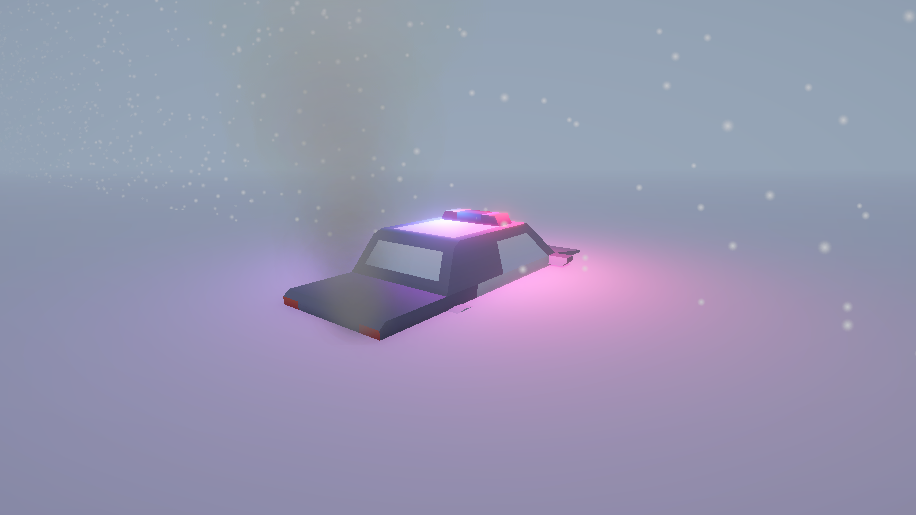

# Escena Invernal de Rescate

Taller Práctico de Unity — *Módulo: Composición de Escenas y Control de Transformaciones*.

Una patrulla de policía queda atrapada y semienterrada por una tormenta de nieve: el motor
sigue encendido (humo en el escape), las sirenas giran y la ventisca arrecia sobre el entorno.

## Requisitos

- Unity **6000.6.6f1** (Unity 6) con el pipeline **URP**
- Linux / Windows / macOS

## Contenido de la escena

`Assets/Scenes/SampleScene.unity` contiene la jerarquía de 10 objetos exigida por el taller:

| # | Objeto | Componente principal | Función |
|---|--------|----------------------|---------|
| 1 | `Main Camera` | Camera | Encuadre lateral/diagonal del coche |
| 2 | `Moon_Light` | Directional Light | Luz general, azul pálido, intensidad baja |
| 3 | `Snow_Terrain` | Plane | Suelo nevado |
| 4 | `Police_Car` | Empty (Y = -0.5) | Objeto padre, semienterrado |
| 5 | `↳ Car_Mesh` | Mesh | Carrocería visible |
| 6 | `↳ Siren_Pivot` | Empty | Pivote de las sirenas (script) |
| 7 | `↳↳ Red_Light` | Point Light | Luz roja de emergencia |
| 8 | `↳↳ Blue_Light` | Point Light | Luz azul de emergencia |
| 9 | `↳ Exhaust_Smoke` | Particle System | Humo del escape |
| 10 | `Global_Blizzard` | Particle System | Nieve cayendo sobre la escena |

## Scripts

- `Assets/Scripts/SirenRotation.cs` — rota `Siren_Pivot` sobre su eje Y con velocidad
  ajustable desde el Inspector (`rotationSpeed`) usando `Transform.Rotate` y `Time.deltaTime`.

## Cómo abrir

1. Abrir el proyecto con Unity Hub (versión 6000.6.6f1).
2. Abrir `Assets/Scenes/SampleScene.unity`.
3. Pulsar **Play**.

## Estado

- [x] Jerarquía de 10 objetos
- [x] Iluminación (luna azulada + sirenas roja/azul rotando)
- [x] `SirenRotation.cs` funcionando en `Siren_Pivot`
- [x] Partículas: nieve (`Global_Blizzard`) y humo (`Exhaust_Smoke`)
- [x] Niebla y ambiente nocturno de ventisca
- [x] Modelo 3D del coche: patrulla low-poly de Kenney (CC0) con material propio
      (`Assets/Models/PoliceCar_Mat.mat`)

## Autor

Juan Pablo Ante — Taller de Laboratorio, Desarrollo de Videojuegos.

## Créditos

- Modelo del coche patrulla: [Kenney Car Kit](https://kenney.nl/assets/car-kit) — licencia **CC0 1.0**
  (dominio público). Ver `Assets/Models/Kenney-License.txt`.
